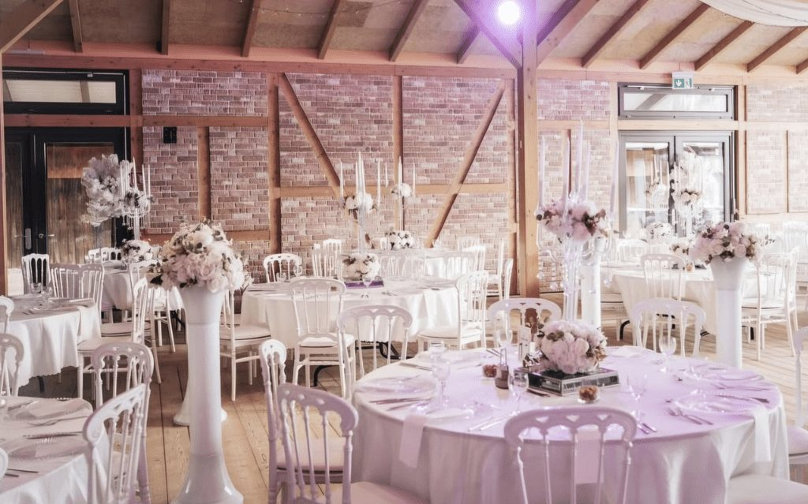

# Hochzeit Isabelle & Yannis

Die Einladungs-Website zu unserer Hochzeit im **Lavenda am See**, Berlin.
Statische Seite ohne Baukasten und ohne Server — einfach `index.html` öffnen.

```
index.html          die ganze Seite (Inhalt & Texte)
css/style.css       Design: Farben, Schriften, Layout
js/main.js          Datum, Countdown, Kalendereintrag, Zusage-Link
images/             Bilder
archiv/             alte Fassung, nicht Teil der Website
```

---

## Als Erstes ausfüllen

### 1. Datum und Rückmeldefrist

Beides in **`js/main.js`**, ganz oben im Block `EUER HOCHZEITS-SETUP`:

```js
beginn:    '2027-07-01T14:00',    // JJJJ-MM-TT + T + HH:MM
ende:      '2027-07-02T02:00',    // ungefähres Ende, für den Kalendereintrag
rsvpFrist: null,                  // z. B. '2027-05-31'
```

Das Datum steht nur hier. Von dort aus füllt es gleichzeitig das Deckblatt,
den Kopfbereich, den Countdown, den Kalendereintrag und den Fuß — eine
Änderung genügt also.

Ist `rsvpFrist` auf `null`, heißt es im Zusage-Abschnitt „rechtzeitig“ statt
eines Datums. Trägt man eine Frist ein, erscheint sie ausgeschrieben.

> Liegt `beginn` in der Vergangenheit, schaltet der Countdown selbständig auf
> „Danke, dass ihr diesen Tag mit uns gefeiert habt“ um und blendet den
> Kalender-Button aus. Wundert euch also nicht, falls das Jahr nicht stimmt.

Die Zusagen laufen über WhatsApp; im Quelltext steht dafür keine Adresse,
die ausgelesen werden könnte.

### 2. Nach jeder Änderung an CSS oder JavaScript

In `index.html` stehen zwei Adressen mit `?v=4`:

```html
<link rel="stylesheet" href="css/style.css?v=4">
<script src="js/main.js?v=4"></script>
```

Wer `style.css` oder `main.js` ändert, zählt diese Zahl um eins hoch. Dann
laden alle Besucher die neue Fassung, statt die alte aus ihrem Browser-Speicher
zu nehmen. Für Änderungen an `index.html` selbst ist das nicht nötig.

### 3. Adresse beim Teilen

In **`index.html`** stehen drei Platzhalter mit `example.github.io`
(`og:url`, `og:image`, `canonical`). Nach dem Veröffentlichen auf die echte
Adresse ändern — davon hängt das Vorschaubild in WhatsApp ab.

### 4. Texte gegenlesen

Der Abschnitt **„Gut zu wissen“** in `index.html` ist von mir vorformuliert:
Kleidung, Geschenke, Fotos, Übernachtung, Reden. Inhaltlich plausibel, aber
nicht mit euch abgestimmt — bitte einmal durchgehen und anpassen.

---

## Inhalte pflegen

### Tagesablauf

Steht in `index.html` im Abschnitt `<section id="ablauf">` als `<ol class="timeline">`.
Eine Zeile sieht so aus:

```html
<li>
  <span class="tl-ico"><svg viewBox="0 0 32 32" aria-hidden="true"><use href="#ico-sekt"/></svg></span>
  <span class="tl-body">
    <span class="tl-time">16:00 Uhr</span>
    <strong class="tl-title">Sektempfang</strong>
  </span>
</li>
```

Zum Ergänzen einen `<li>`-Block kopieren und Zeit, Text und Symbolnamen ändern.
Links und rechts wechseln sich von allein ab, auf dem Handy wird daraus eine
Spalte. Verfügbare Symbole — gezeichnet und ganz oben in `index.html` abgelegt:

| Name | zeigt |
|------|-------|
| `ico-bogen` | Trauungsbogen |
| `ico-ringe` | zwei Ringe |
| `ico-sekt` | zwei Sektgläser |
| `ico-torte` | Hochzeitstorte |
| `ico-kamera` | Fotoapparat |
| `ico-essen` | Gedeck mit Besteck |
| `ico-disco` | Discokugel |
| `ico-snack` | Schale mit Snacks |

### Menü

Noch offen. Im Abschnitt `<section id="essen">` den Block
`<div class="pending"> … </div>` löschen und ersetzen durch:

```html
<ul class="menu">
  <li>Frische Sommersalate &amp; Antipasti</li>
  <li>Vegetarische Spezialitäten</li>
</ul>
```

### Dresscode

Im Abschnitt `<section id="dresscode">`. Die Farbpunkte sind reines CSS — Farbe
und Name stehen direkt beieinander:

```html
<li><span class="swatch" style="--farbe: #e9a8ae"></span>Rosa</li>
```

Zum Ändern den Farbwert tauschen, zum Ergänzen die Zeile kopieren. Vier bis
fünf Farben sehen am besten aus, danach wird die Reihe auf dem Handy unruhig.

### Musikwünsche

Die Playlist steht an zwei Stellen in `<section id="musik">`: einmal im
`<iframe src="...">` und einmal im Button darunter. Bei einer anderen Playlist
beide Adressen austauschen — im `iframe` muss `/embed/` in der Adresse bleiben,
und `&amp;theme=0` sorgt für das ruhige Dunkelgrau statt der grellen Cover-Farbe.

> **Damit Gäste wirklich Lieder eintragen können**, muss die Playlist in Spotify
> auf **gemeinsam/kollaborativ** stehen (in Spotify: Playlist → ⋯ → „Gemeinsame
> Playlist“). Sonst können sie sie nur anhören. Zum Eintragen brauchen Gäste
> außerdem ein eigenes Spotify-Konto; das geht auch mit dem kostenlosen.

## Bilder tauschen

Jedes Bild liegt zweimal in `images/`: als `.webp` (klein, für alle neueren
Browser) und als `.jpg` (Rückfall für ältere Geräte). Im Quelltext stehen beide
zusammen in einem `<picture>`:

```html
<picture>
  <source srcset="images/lavenda2.webp" type="image/webp">
  
</picture>
```

Der Browser nimmt die erste Fassung, die er versteht — ohne JavaScript, ohne
Umweg. Es gibt zwei solche Stellen: `lavenda1` ist das Deckblatt, `lavenda2`
das Bild im Abschnitt „Willkommen".

Für ein neues Bild beide Fassungen erzeugen. Mit Python und Pillow:

```bash
python -c "from PIL import Image; b=Image.open('neu.png').convert('RGB'); b.save('images/neu.webp','WEBP',quality=82,method=6); b.save('images/neu.jpg','JPEG',quality=84,optimize=True,progressive=True)"
```

Dann im `<picture>` beide Dateinamen eintragen und `width`/`height` auf die
echten Maße setzen — die verhindern, dass die Seite beim Laden springt.

> Die unkomprimierten Originale liegen in `archiv/` und gehören nicht ins
> Repository. Aus den beiden PNG mit zusammen 737 KB wurden 200 KB in WebP —
> auf dem Handy im Mobilfunknetz macht das den Unterschied zwischen „ist sofort
> da" und „baut sich auf".

Wenn ihr das Deckblatt tauscht, denkt auch an `og:image` im Kopf von
`index.html` — das ist das Vorschaubild beim Teilen und sollte auf die
`.jpg`-Fassung zeigen, nicht auf `.webp`.

## Veröffentlichen mit GitHub Pages

Das Repository ist bereits angelegt — nicht hier, sondern unter
`C:/Users/yanni/Projekte/hochzeit-website`. Grund: Dieser Ordner liegt in Google Drive, und Drive
synchronisiert auch den versteckten `.git`-Ordner. Dabei schreibt es mitten in
laufende Git-Vorgänge und beschädigt Repositories regelmäßig.
**Die Fassung in `Projekte` ist ab jetzt die maßgebliche**, diese hier ist die
Sicherung.

Es fehlen nur noch drei Schritte:

**1.** Auf github.com ein neues, leeres Repository anlegen — ohne Haken bei
„Add a README file", sonst gibt es beim ersten Push einen Konflikt.

**2.** Verbinden und hochladen (`BENUTZERNAME` und `NAME` ersetzen):

```bash
git -C "C:/Users/yanni/Projekte/hochzeit-website" remote add origin https://github.com/BENUTZERNAME/NAME.git
```

```bash
git -C "C:/Users/yanni/Projekte/hochzeit-website" push -u origin main
```

**3.** Im Repository unter **Settings → Pages** bei *Source* `Deploy from a
branch` wählen, Branch `main`, Ordner `/ (root)`. Nach etwa einer Minute liegt
die Seite unter `https://BENUTZERNAME.github.io/NAME/`.

Danach die drei `example.github.io`-Platzhalter in `index.html` auf diese
Adresse ändern und erneut hochladen — davon hängt das Vorschaubild beim Teilen
ab.

> Ein öffentliches Repository ist für alle lesbar, auch die Adresse der
> Location. Für ein privates Repository braucht GitHub Pages einen bezahlten
> Plan; die Alternative ist, die Seite öffentlich zu stellen und den Link
> einfach nicht zu streuen.

### Spätere Änderungen

```bash
git -C "C:/Users/yanni/Projekte/hochzeit-website" add -A
```

```bash
git -C "C:/Users/yanni/Projekte/hochzeit-website" commit -m "Menue ergaenzt"
```

```bash
git -C "C:/Users/yanni/Projekte/hochzeit-website" push
```

GitHub Pages baut die Seite danach von allein neu.

## Was die Seite sonst noch kann

- **Deckblatt** mit „Einladung öffnen“, das sich per Klick, Enter oder
  Pfeiltaste öffnet. Ein geteilter Link mit `#` (z. B. `…/#zusagen`)
  überspringt es und springt direkt zum Abschnitt.
- **Countdown** bis zum Fest, der am Tag selbst auf „Heute ist es so weit“
  umschaltet und danach auf einen Dankessatz.
- **Kalender-Button**, der eine `.ics`-Datei erzeugt — mit Zeitzone
  Europe/Berlin und einer Erinnerung einen Tag vorher.
- **Lavendelzweig** als Trenner unter jeder Überschrift, direkt als SVG im
  Stylesheet. Farben ändern sich über `--gold` und `--lavender` in `:root`.
- **Teilen-Button**: nutzt das Teilen-Menü des Handys, am Rechner kopiert er
  den Link.
- **Ohne JavaScript** wird das Deckblatt übersprungen und der ganze Inhalt
  direkt angezeigt. Nichts bleibt unerreichbar.
- **Drucken** ergibt eine saubere Fassung ohne Deckblatt, Navigation und
  Buttons, mit ausgeklappten Antworten und ausgeschriebenen Links.
- **Barrierefrei** nutzbar: Sprunglink, Tastaturbedienung, sichtbarer Fokus,
  und bei `prefers-reduced-motion` sind alle Animationen aus.

---

## Lokal anschauen

`index.html` doppelklicken genügt. Wer die Seite so testen will, wie sie
später im Netz liegt:

```bash
python -m http.server 8000
```

Dann `http://localhost:8000` im Browser öffnen.
